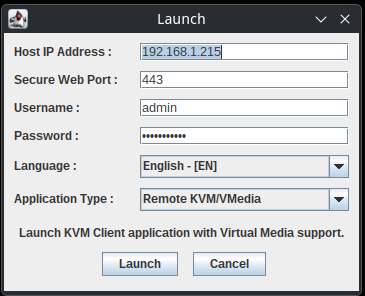
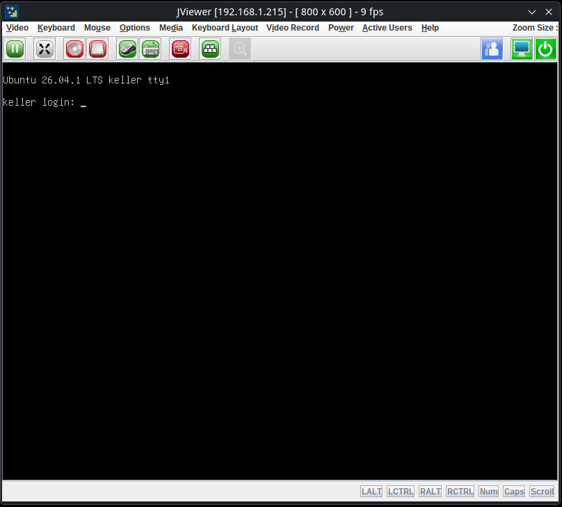

# MegaRAC JViewer KVM launcher (no Java Web Start)

Run the AMI MegaRAC JViewer remote console (iKVM, Console Redirection) on Java 21+ without a
browser or `jviewer.jnlp`. Fixes the black screen at 0 fps on MegaRAC SP-X BMCs such as the
GIGABYTE MZ32-AR0.

## Quick start

```sh
git clone <this repo>
cd megarac-jviewer-kvm
./megarac-kvm.sh
```

JViewer opens its connection dialog and asks for the BMC address, user and password.
On Windows, run `megarac-kvm.cmd`.



After **Launch**, the console shows the host screen:



Keyboard, mouse and the rest of JViewer's menus (power control, virtual media) are JViewer's
own. Video, keyboard and mouse are tested; virtual media is not.

## Requirements

- Java 21 or newer. Set `JAVA=/path/to/java` if the `java` on your PATH is older.
- A MegaRAC SP-X BMC with the REST web API, reachable on HTTPS port 443. See
  [Will it work on my board?](#will-it-work-on-my-board)

## Symptoms this fixes

| What you see | Cause | Fix in this repo |
|---|---|---|
| Clicking **Launch JViewer** downloads `jviewer.jnlp` and nothing happens | Java Web Start was removed in Java 11 | JViewer runs in StandAlone mode from bundled jars |
| "unable to access native libraries" | JViewer loads its natives from a path the BMC's jars don't use | `jviewer/natives.jar` puts them there |
| "reconnect in progress" (or "Connection in progress") forever | JViewer probes legacy `/rpc/*.asp` endpoints, misses single-port mode and dials port 7578, which is closed | the runner passes `-restService 1` |
| Window opens, black screen, **0 fps** in the title bar | JViewer never sends its session token (see below) | `agent/packetfix.jar` |
| `JARSigningException`, "weak signature algorithm", Java security prompts | Web Start checks AMI's expired jar signature | no Web Start, so no check |

## Symptoms it doesn't fix

| What you see | Likely cause | Try |
|---|---|---|
| 0 fps, and the BMC's own H5Viewer is black too | the host draws on a discrete GPU, or the host console is blanked | BIOS: set onboard VGA as primary display; Linux: `consoleblank=0` |
| "Invalid Session Token", "Max session limit", login fails | the BMC is hung or out of sessions | `ipmitool -I lanplus -H <bmc> -U <user> -P <pass> mc reset cold` (restarts the BMC only, not the host) |

## How the black-screen fix works

`agent/packetfix.jar` is a Java agent that patches two JViewer methods in memory when they
load. The vendor jars on disk are not changed.

- **`JViewerApp.getMacAddress`** now returns `00-00-00-00-00-00`. JViewer needs the client MAC
  for its session packet. When the lookup fails it logs "Failed to get mac Address" and skips
  sending the session token, so the BMC never starts the video stream. The BMC's own HTML5
  viewer sends the same placeholder.
- **`Client.sendMessage`** rewrites the header of the session packet (IVTP type 18) before it
  goes out. JViewer sets its size to 446, header included, and its status to 0. The HTML5
  viewer, which the firmware accepts, sends 438 (body only) and status 1.

`PACKETFIX_TRACE=1 ./megarac-kvm.sh` logs the header of every packet JViewer sends.

## Will it work on my board?

Tested on GIGABYTE MZ32-AR0 rev 1.0, BMC firmware 12.61.39 (built 2025-07-02), ASPEED SoC,
BIOS R44. The bundled JViewer jars come from that BMC; [`jviewer/SOURCE.md`](jviewer/SOURCE.md)
lists each file and its SHA-256.

It should work on other BMCs running the same MegaRAC SP-X generation, which GIGABYTE, ASRock
Rack, Tyan and others ship on AST2500/AST2600 boards. Signs that yours is one:

- the web UI has **Remote Control** with both H5Viewer and JViewer,
- `curl -sk https://<bmc>/api/kvm/token` answers 401 instead of 404.

If JViewer from this repo doesn't match your firmware, copy your BMC's own jars from
`https://<bmc>/Java/release/` into `jviewer/` (rebuild `natives.jar` as described in
`SOURCE.md`). None of this is tested beyond the board above.

Older firmware that logs in through `/rpc/WEBSES/create.asp` (Supermicro X8/X9, ASUS
ASMB8-iKVM, older ASRock Rack) does not have the REST API this launcher relies on. Use
[nojava-ipmi-kvm](https://github.com/sciapp/nojava-ipmi-kvm) or
[jviewer-starter](https://github.com/dfuchslin/jviewer-starter) there.

## Platforms

| Platform | Status |
|---|---|
| Linux x86-64 | tested |
| Linux i386, Windows x86-64 and i386 | natives bundled, untested |
| macOS x86-64 | natives bundled, untested |
| macOS on Apple Silicon | bundled natives are x86-64 only, so it needs an x86-64 Java under Rosetta. Untested |

## Why not OpenWebStart, IcedTea-Web or the H5Viewer?

- **OpenWebStart / IcedTea-Web** can start `jviewer.jnlp`, but they run the unpatched JViewer,
  which has the 0 fps bug above. They also need the signature exceptions that expired AMI
  certificates trigger. (Not tested through Web Start here.)
- **H5Viewer** works, but only inside the BMC web UI in a browser tab.

## Rebuilding the agent

```sh
agent/build.sh            # or JDK=/path/to/jdk agent/build.sh
```

It downloads ASM 9.8 from Maven Central (pinned SHA-256), compiles `agent/src/PacketFix.java`
for Java 21, and writes `agent/packetfix.jar` with ASM shaded in.

## License

The runner scripts and the agent are Apache-2.0, see [`LICENSE`](LICENSE).

The files in `jviewer/` are copyright American Megatrends and are not covered by that license.
ASM, shaded into `packetfix.jar`, is BSD-3-Clause, see
[`agent/LICENSE-ASM.txt`](agent/LICENSE-ASM.txt).

The runner scripts and this README were generated with Claude Code (Anthropic).
